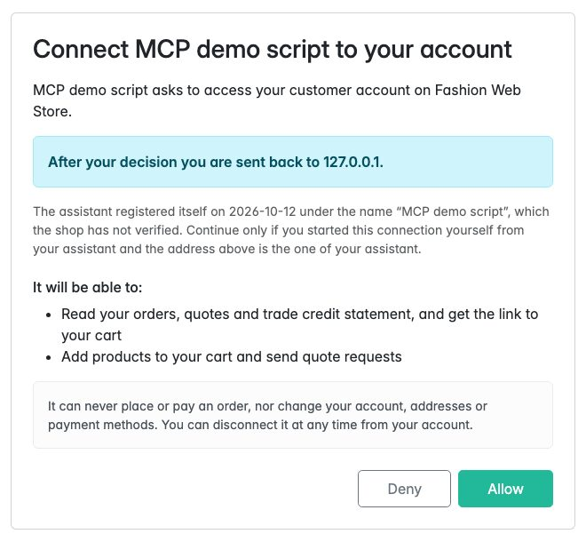
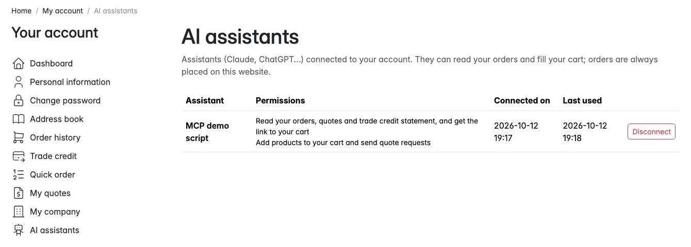
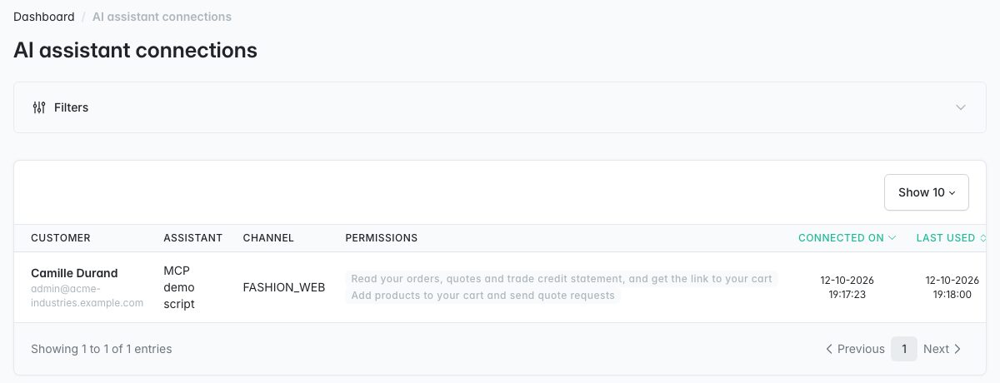
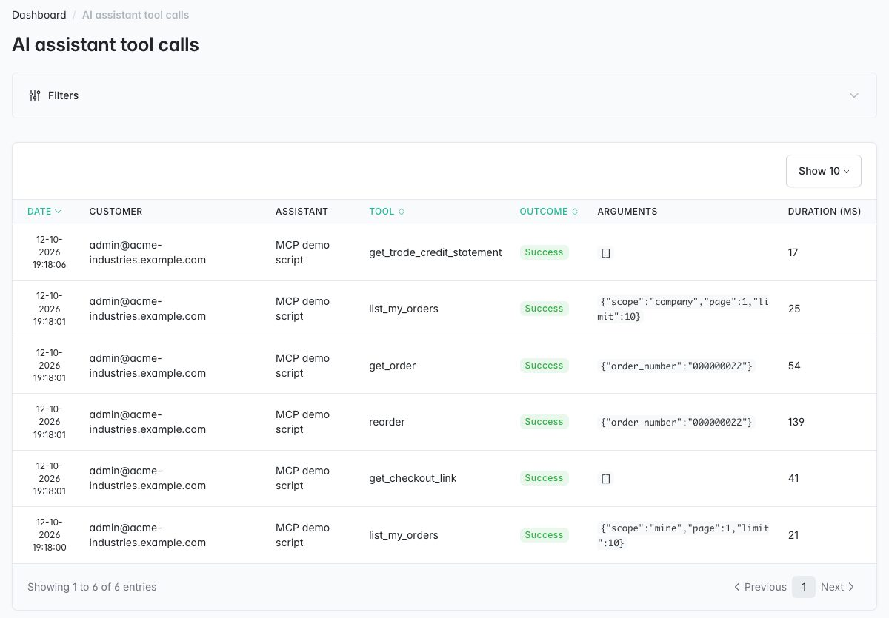

# Sylius B2B MCP Plugin

> Français : [README.fr.md](README.fr.md) <!-- vitrine:lang -->

[](https://github.com/thibmonier/sylius-b2b-mcp-plugin/actions/workflows/build.yaml)
[](LICENSE)

**B2B tools for the official Sylius MCP server: your business customers connect Claude or
ChatGPT to their own shop account to find past orders, reorder, quick order by SKU, request
quotes and check their trade credit. They still place and pay their orders on your website.**

[sylius/mcp-server-plugin](https://github.com/Sylius/McpServerPlugin) exposes a Sylius shop to AI
assistants through the Model Context Protocol, as a guest: catalog search and a guest checkout.
A purchasing manager who reorders every month needs their account instead: their orders, their
prices, their company, their quotes, their credit.

This plugin adds that to the same MCP server (it is not a second server): OAuth 2.1 sign-in
with the customer's shop account, and tools scoped to that customer and to the channel. The
assistant prepares the cart; the customer reviews it and orders on the shop, where the order
button, the legal information and the payment stay under your control.

It is a B2B tool for customers who add the connector themselves. It does not list your shop in
the ChatGPT or Claude directories (that needs their review), and it does not sell "in" ChatGPT,
Gemini or Claude: no order and no payment happen in the assistant.

## Features

| Need | What the plugin does |
|---|---|
| Sign in with the shop account | **OAuth 2.1 authorization server** for the MCP endpoint: authorization code with **PKCE (S256 only)**, rotating refresh tokens, dynamic client registration (RFC 7591), discovery metadata (RFC 8414, RFC 9728), revocation (RFC 7009). The customer signs in on the shop and approves the assistant on a consent page of their account. Built on [league/oauth2-server](https://oauth2.thephpleague.com/). |
| Find past orders | `list_my_orders`, `get_order`: placed orders of the customer on the channel, with lines, SKU, prices, totals and states. |
| Reorder | `reorder`: the items of a past order go into the cart at today's prices; each line says *added*, *adjusted*, or why not (no longer sold, out of stock, quantity rules), and whether the price changed. |
| Quick order by SKU | `quick_order_add` (with [tmonier/sylius-quick-order-plugin](https://github.com/thibmonier/sylius-quick-order-plugin)): preview first, then add with the same validation as the quick order page (pack sizes, stock, partial or all-or-nothing). |
| Request a quote | `request_quote`, `list_my_quotes` (with [tmonier/sylius-quote-request-plugin](https://github.com/thibmonier/sylius-quote-request-plugin)): from the cart or from SKU lines, with a message; the merchant answers in the shop as usual. |
| Know the credit left | `get_trade_credit_statement` (with [tmonier/sylius-trade-credit-plugin](https://github.com/thibmonier/sylius-trade-credit-plugin)): limit, committed, available, open items, overdue amount and ageing. |
| Company buyers | With [tmonier/sylius-company-accounts-plugin](https://github.com/thibmonier/sylius-company-accounts-plugin): `list_my_orders` with `scope: company`, `get_order` and `reorder` on the company orders, as the company roles allow (its voters decide). |
| Approve purchase orders *(1.1)* | With [tmonier/sylius-purchase-approval-plugin](https://github.com/thibmonier/sylius-purchase-approval-plugin): `list_pending_approvals` for approvers (buyer, total against the limit, age, whether they may approve); `get_order` shows the approval of an order; **opt-in** `decide_approval` (approve or reject with a comment, same rules as the shop page) behind its own permission `b2b:approve`. |
| Hand over to the checkout | `get_checkout_link`: the cart and the link to review it and check out on the website, signed in with the same account (Sylius loads the latest cart of the customer). |
| Keep the assistant out of the checkout | The guest cart and checkout tools of the official server (`create_order`, `complete_checkout`, ...) are hidden by default; its catalog tools stay. |
| One audit trail *(1.1)* | With [tmonier/sylius-audit-log-plugin](https://github.com/thibmonier/sylius-audit-log-plugin): tool calls (without arguments), consents and revocations also appear in its log and in the customer history. |
| Stay in control | One **connection** per customer, assistant and channel: listed in *My account > AI assistants* (disconnect) and in the admin (*Customers > AI assistant connections*, revoke). **Audit log** of every tool call (customer, assistant, arguments, outcome, duration) in the admin. Rate limits per connection and on the OAuth endpoints. |

Tools whose plugin is not installed are simply not registered. Translations in English, French,
German, Spanish, Italian, Dutch and Polish; MySQL, MariaDB and PostgreSQL.

### Tools

| Tool | Scope | Changes | Needs |
|---|---|---|---|
| `list_my_orders` | `b2b:read` | nothing | - |
| `get_order` | `b2b:read` | nothing | - |
| `reorder` | `b2b:cart` | the cart (idempotency key) | - |
| `get_checkout_link` | `b2b:read` | nothing | - |
| `quick_order_add` | `b2b:read` to preview, `b2b:cart` to add | the cart (idempotency key) | quick order plugin |
| `request_quote` | `b2b:cart` | sends a quote request (idempotency key) | quote request plugin |
| `list_my_quotes` | `b2b:read` | nothing | quote request plugin |
| `get_trade_credit_statement` | `b2b:read` | nothing | trade credit plugin |
| `list_pending_approvals` | `b2b:read` | nothing | purchase approval plugin |
| `decide_approval` | `b2b:approve` | approves or rejects (a rejected order is cancelled; idempotency key) | purchase approval plugin + `approvals.allow_decisions: true` |

No tool places an order, pays, or changes the account, the addresses or the payment methods.

### Approval decisions from an assistant (opt-in)

`decide_approval` is **off by default**. With `approvals.allow_decisions: true`, the shop offers
the `b2b:approve` permission; on the consent page it is a separate, **never pre-ticked**
checkbox with a warning, and a client asking for no scope never gets it. The tool applies the
rules of the shop page (approver of the order's company, no self-approval, approval limit, order
still new, one decision under a lock) and records the approver as the decider.

The risk is **prompt injection**: text the assistant reads (a product name, an order, a quote
message, a web page) could try to make it approve an order. Mitigations: the tool description
tells the model to call it only on the user's explicit request after showing the order; the
decision is limited by the approver's approval limit; every call is audited; and
**keep tool confirmations on in your assistant** (Claude and ChatGPT ask before running a tool
that is not read-only: `decide_approval` is annotated as destructive). Enable it only for
approvers who understand this.

Turning `allow_decisions` off takes `b2b:approve` away from every connection for good (at the
cache warmup of the deployment, else on the first MCP request or token refresh, and in
`tmonier:b2b-mcp:purge`); the connections keep `b2b:read` and `b2b:cart` and their refresh keeps
working. Turning it back on never restores the permission: each approver ticks it again on a
new consent.

## Screenshots









## Requirements

| | Version |
|---|---|
| PHP | 8.2+ (8.3+ with Sylius 2.3) |
| Sylius | 2.2.9+, 2.3 |
| Symfony | 7.4 (Sylius 2.2); 7.4, 8.x (Sylius 2.3) |
| sylius/mcp-server-plugin | 0.2 (installed as a dependency, with symfony/mcp-bundle 0.3) |
| league/oauth2-server | 9 (installed as a dependency) |

**Symfony 6.4 is not supported**: symfony/mcp-bundle, which the official MCP plugin is built
on, requires Symfony 7.3 or later. The official plugin is beta (0.x); see Limitations.

The shop must be reachable over **HTTPS on a public host name**: Claude and ChatGPT connect to
it from their servers. Behind a reverse proxy, configure the
[trusted proxies](https://symfony.com/doc/current/deployment/proxies.html) so that the URLs of
the OAuth metadata use `https` and the public host.

## Installation

1. Require the package:

    ```bash
    composer require tmonier/sylius-b2b-mcp-plugin
    ```

2. Register the bundles in `config/bundles.php` (the first two may already be there):

    ```php
    Symfony\AI\McpBundle\McpBundle::class => ['all' => true],
    Sylius\McpServerPlugin\SyliusMcpServerPlugin::class => ['all' => true],
    Tmonier\SyliusB2bMcpPlugin\TmonierSyliusB2bMcpPlugin::class => ['all' => true],
    ```

3. Import the configuration and the routes of both plugins:

    ```yaml
    # config/packages/tmonier_sylius_b2b_mcp.yaml
    imports:
        - { resource: "@SyliusMcpServerPlugin/config/config.yaml" }
        - { resource: "@TmonierSyliusB2bMcpPlugin/config/config.yaml" }
    ```

    ```yaml
    # config/routes/tmonier_sylius_b2b_mcp.yaml
    sylius_mcp_server:
        resource: "@SyliusMcpServerPlugin/config/routes.yaml"

    tmonier_sylius_b2b_mcp:
        resource: "@TmonierSyliusB2bMcpPlugin/config/routes.yaml"
    ```

    No change to `security.yaml` is needed (see How it works).

4. Run the migration (plugin tables only, core tables are not changed):

    ```bash
    bin/console doctrine:migrations:migrate
    ```

5. Set a dedicated encryption key (it protects authorization codes and refresh tokens; it
   defaults to the kernel secret):

    ```yaml
    # config/packages/tmonier_sylius_b2b_mcp.yaml
    tmonier_sylius_b2b_mcp:
        oauth:
            encryption_key: '%env(TMONIER_B2B_MCP_ENCRYPTION_KEY)%'
    ```

6. Schedule the clean-up once a day: `bin/console tmonier:b2b-mcp:purge` (expired tokens,
   clients registered but never connected, old idempotency keys, audit entries older than the
   retention period).

The MCP endpoint is the HTTP path of symfony/mcp-bundle: `https://your-shop.example.com/_mcp`
with sylius/mcp-server-plugin 0.2.

## Connecting an assistant

The customer needs a shop account on the channel (host name) of the URL.

### Claude (custom connector)

1. In Claude (web or desktop): *Settings > Connectors > Add custom connector*.
2. Name it after the shop, URL `https://your-shop.example.com/_mcp`, no client ID needed
   (Claude registers itself).
3. *Connect*: Claude opens the shop; the customer signs in and clicks *Allow* on the consent
   page. On Team and Enterprise plans, an owner may have to add the connector first.

Claude uses the callback `https://claude.ai/api/mcp/auth_callback` (and `claude.com`), allowed by
default. Claude Code connects from a local callback (`claude mcp add --transport http shop
https://your-shop.example.com/_mcp`): enable `allow_loopback_redirect_uris` for it.

### ChatGPT (developer mode, Business and Enterprise)

1. Enable developer mode (*Settings > Apps & Connectors > Advanced settings*), or ask the
   workspace admin on Business and Enterprise plans.
2. *Create* a connector (app) with the URL `https://your-shop.example.com/_mcp` and OAuth
   authentication; ChatGPT registers itself.
3. Connect: ChatGPT opens the shop for the sign-in and the consent.

ChatGPT uses `https://chatgpt.com/connector_platform_oauth_redirect` or a per-app callback
`https://chatgpt.com/connector/oauth/{id}`, both allowed by default.

The availability of custom connectors depends on the plan and the country of the user, and
changes often: check the current documentation of
[Anthropic](https://support.claude.com/en/articles/11503834) and
[OpenAI](https://developers.openai.com/apps-sdk/build/auth). Listing the shop in a public
directory (ChatGPT apps, Claude connectors directory) requires their review and is outside the
scope of this plugin.

### Fixed client ID instead of dynamic registration

Some setups prefer to register the assistant once:

```bash
bin/console tmonier:b2b-mcp:create-client "Claude" --redirect-uri=https://claude.ai/api/mcp/auth_callback [--confidential]
```

and enter the client ID (and secret) in the advanced settings of the connector. Dynamic
registration can then be switched off (`oauth.dynamic_client_registration: false`).

**Recommended in production when your customers can be given a client ID:** disable dynamic
registration and create one client per assistant with the command. With dynamic registration
on (needed for the one-click "Add connector" flow), anyone can register a client and choose its
name; the redirect URI allow-list keeps the codes on the assistants' own hosts, and the consent
page names the assistant after that verified host (Claude, ChatGPT), shows the host
prominently and flags self-registered clients ("registered itself on <date> under the name
... not verified by the shop").

## Restricting the accounts that may connect an assistant (extension point)

By default any enabled shop account may connect an assistant and call the endpoint. To add a rule of your
application (registration not approved, account suspended, contract ended...), implement
`Tmonier\SyliusB2bMcpPlugin\Account\AccountUsabilityCheckerInterface`; it is tagged
`tmonier_b2b_mcp.account_usability_checker` by autoconfiguration (a tag priority orders several checkers):

```php
final class ApprovedRegistrationChecker implements AccountUsabilityCheckerInterface
{
    public function check(CustomerInterface $customer): AccountUsability
    {
        return $this->isApproved($customer) ? AccountUsability::usable() : AccountUsability::refused('registration_pending');
    }
}
```

- The checkers are asked at the OAuth consent (page and decision: a refused account gets a 403, no connection and
  no authorization code) and at **every call of `/_mcp`**, after the token is resolved: an access token issued
  before the refusal gets a 403 `access_denied` with `Cache-Control: private, no-store`, and the refusal is
  written to the audit log (tool `account_usability`, outcome `refused`, with your reason).
- The first refusal wins; later checkers are not asked. A checker that throws refuses (fail closed): the error is
  logged (channel `mcp`), the client only sees `access_denied`.
- The reason (a short machine-readable string) is never sent to the client. An unknown, expired or revoked token
  is still a 401 and no checker is called.
- The rate limit of the connection is applied before the checkers: a flood of refused calls is limited (429) and does not
  fill the audit log.
- The checkers run on every call: keep them cheap and independent of the request (the customer is the only
  input). The token endpoint is not checked: a refresh gives a token that the endpoint then refuses.

## Configuration

Optional, with the defaults:

```yaml
tmonier_sylius_b2b_mcp:
    endpoint_path: ~                 # defaults to mcp.http.path (symfony/mcp-bundle), then /_mcp
    hidden_official_tools:           # tools of sylius/mcp-server-plugin not registered
        - create_order
        - add_item_to_order
        - fetch_order
        - update_order_address
        - list_shipping_methods
        - select_shipping_method
        - list_payment_methods
        - select_payment_method
        - complete_checkout
    oauth:
        encryption_key: '%kernel.secret%'
        access_token_ttl: PT1H
        refresh_token_ttl: P30D
        auth_code_ttl: PT10M
        dynamic_client_registration: true
        redirect_uris:               # exact, or "*" for one path segment
            - https://claude.ai/api/mcp/auth_callback
            - https://claude.com/api/mcp/auth_callback
            - https://chatgpt.com/connector_platform_oauth_redirect
            - https://chatgpt.com/connector/oauth/*
        allow_loopback_redirect_uris: false   # http://localhost:<port> (Claude Code, MCP Inspector)
    rate_limit:
        mcp_requests_per_minute: 120          # per connection
        oauth_requests_per_minute: 60         # token/revocation: per client; authorize: per IP
        client_registrations_per_hour: 60     # per IP
        cache_pool: cache.rate_limiter
    approvals:
        allow_decisions: false                # decide_approval and the b2b:approve permission (opt-in)
    audit_log_bridge: true                    # with tmonier/sylius-audit-log-plugin
    max_page_size: 50
    idempotency_ttl_hours: 24
    audit_retention_days: 90
```

`hidden_official_tools: []` keeps the whole guest checkout of the official server (the guest
tools then work next to the B2B ones, with a separate guest cart).

## How it works

- **Extension, not a second server.** The tools are registered on the server of
  symfony/mcp-bundle through its loader extension point (`mcp.loader`), the mechanism used by
  sylius/mcp-server-plugin itself. A decorator of the MCP registry leaves out the hidden
  official tools.
- **Authentication.** A request listener runs before the firewall on the MCP route (decided on
  the route matched by the router, so encoded spellings such as `/%5Fmcp` are covered): without a
  valid bearer token, the answer is a 401 with
  `WWW-Authenticate: Bearer resource_metadata=".../.well-known/oauth-protected-resource/_mcp"`,
  which starts the OAuth flow in Claude and ChatGPT. A shop session cookie is never enough.
  After the firewall, the shop user becomes the security token of the request (so the Sylius
  and plugin voters apply) and nothing is stored in a session.
- **Tokens.** Access tokens are opaque random strings (80 hexadecimal characters); only their
  SHA-256 hash is stored, so a database leak gives no usable token and no key pair has to be
  managed. A token belongs to a connection (customer, assistant, channel): it only works on the
  host name of that channel, for an enabled shop user, while the connection is active.
  Refresh tokens rotate; presenting a spent refresh token or authorization code again revokes
  every token of the connection.
- **Consent.** `/mcp-oauth/authorize` checks the request (client, registered redirect URI still
  allowed, PKCE S256, `resource` naming this endpoint) and sends the browser to
  `/{locale}/account/ai-assistants/authorize`, behind the shop login. The page names the
  assistant after the host it returns to when it is a known one (otherwise the declared name,
  stripped of control and bidi characters), shows that host prominently, flags clients that
  registered themselves, and lists the permissions; it cannot be framed.
- **Same rules as the shop.** Carts are the customer's latest cart on the channel (the one the
  shop shows after login). Lines go through the quick order adder when that plugin is
  installed (as its reorder button does), otherwise through the core rules (enabled, sold in
  the channel, priced, in stock, quantity limit), then through the Sylius order processor.
  Quote requests go through the quote request factory and manager (rate limit by e-mail
  included). Company access goes through the voters of the company accounts plugin.
- **Prompt injection hygiene.** Tool results are JSON data with plain text (tags and control
  characters removed, lengths capped); each tool description says its result is shop data,
  never instructions. No tool can change account settings, addresses or payment methods, and
  nothing is ordered without the customer acting on the website.
- **Idempotency.** `reorder`, `quick_order_add` (confirm) and `request_quote` require an
  `idempotency_key`: a retry with the same key and arguments returns the stored result
  (`"replayed": true`), the same key with other arguments is refused.

## Personal data

- **Audit log** (`tmonier_b2b_mcp_tool_call`): customer, e-mail, assistant name, IP address of
  the assistant's server, tool, arguments (free text written by the customer, such as the
  message of a quote request, comment of an approval decision, is replaced by its length), outcome. Kept `audit_retention_days`
  (90 by default, `tmonier:b2b-mcp:purge`). Purpose: security and support of the merchant's
  own service; document it in your privacy policy.
- **Idempotency keys**: the result of cart-changing calls, kept `idempotency_ttl_hours` (24).
- **Connections and tokens**: customer, assistant, channel, scopes, dates; tokens are stored
  hashed and purged a day after they expire.
- Deleting a customer deletes their connections, tokens, audit entries and idempotency keys
  (foreign keys `ON DELETE CASCADE`, so also when the row is deleted outside Doctrine).
- The assistant (Anthropic, OpenAI) receives the data returned by the tools as an independent
  controller under its own terms: tell your customers in your privacy policy.

## Demo data

The test application loads the fixtures of the companion plugins: `b2b@example.com` / `sylius`
(trade credit account with open items), the Acme Industries company
(`admin@acme-industries.example.com`, `buyer@...`, `approver@...` / `sylius`, with orders) and
quote requests.

## Limitations

- **sylius/mcp-server-plugin is beta.** Its tagged 0.2 requires symfony/mcp-bundle 0.3 (January
  2026); its main branch moved to mcp-bundle 0.13 with several servers (`/mcp/shop`), not tagged
  yet. This plugin targets the tagged 0.2; the registration of the tools will need an update when
  Sylius tags the next version.
- The official guest tools that stay (catalog) call the Shop API over HTTP as a guest, as
  before; they are not rate limited nor audited by this plugin.
- No payment and no order completion in the assistant (on purpose): in-assistant checkout is not
  available to EU merchants today, and B2B buyers order from the website.
- No MCP Apps (interactive UI in the assistant): results are text and structured data.
- The stdio transport (`bin/console mcp:server`) has no customer: the B2B tools refuse.
- One issuer per shop host; scopes are coarse (`b2b:read`, `b2b:cart`). Dynamic registration is
  open, protected by the redirect URI allow-list and the consent page (showing the host the
  assistant returns to).
- Prices in results are decimal strings in the order currency, with two decimals like the shop.
- The audit log bridge records the events whatever the `sources` setting of the audit log plugin
  (customer actions are not recorded there by default); its anonymization command covers them,
  the deletion of a customer does not (no foreign key in that plugin).
- Tested locally with MySQL 8.4; the MariaDB and PostgreSQL jobs of the CI matrix were not run locally.

## Development

```bash
docker compose up -d mysql mailhog   # host ports in compose.override.yml (gitignored)
composer database-reset              # dev database with fixtures (APP_ENV=test for the test one)
vendor/bin/phpunit                   # every suite once (unit, integration, functional)
vendor/bin/phpstan analyse
vendor/bin/ecs check
```

See [SPEC.md](SPEC.md) for the research and design decisions.

<!-- vitrine:demo-b2b:start -->
## B2B demo

This plugin is used in the [Sylius B2B demo](https://github.com/thibmonier/sylius-b2b-demo): a Sylius 2.3 shop with fictitious sample data where the B2B plugins work together. The source code, setup and fixtures of the demo are in that repository.

- Online demo: [sylius-b2b.thibaut-monier.fr](https://sylius-b2b.thibaut-monier.fr)
- Author: [Thibaut Monier](https://www.linkedin.com/in/thibautmonier/)

The demo is an example, not a production setup.
<!-- vitrine:demo-b2b:end -->

## License

MIT, see [LICENSE](LICENSE).
